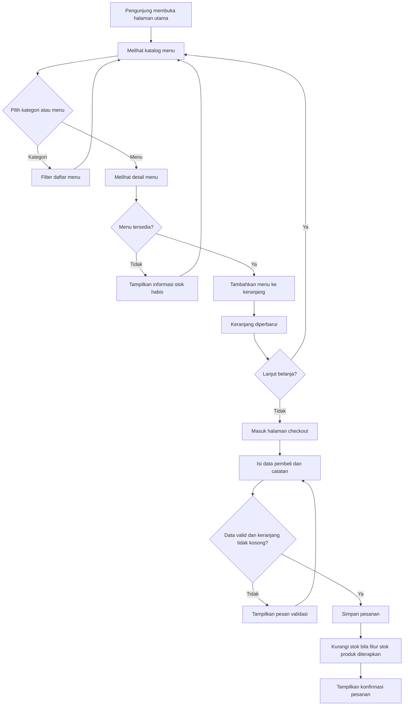
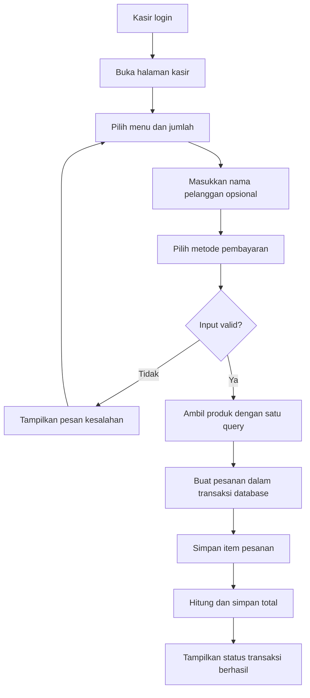
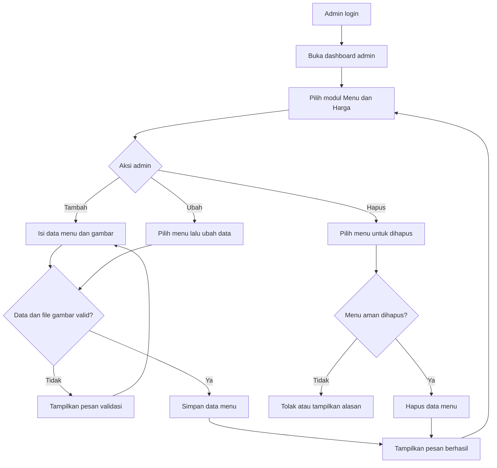

# Diagram Program — Warmindo Smoky

**Fase:** 2 — Persiapan Lingkungan Pengembangan  
**Tanggal:** 18 Oktober 2026

Dokumen ini adalah rancangan alur. Dokumen tidak menjalankan kode, tidak mengubah route, dan tidak mengubah database.

## 1. Alur Pelanggan Memilih Menu

## 2. Alur Kasir Membuat Pesanan

## 3. Alur Admin Mengelola Menu

## 4. Deskripsi Halaman Utama

| Halaman/route Laravel | Tujuan | Pengguna | Data utama |
|---|---|---|---|
| `/` | Beranda Warmindo Smoky dan akses awal katalog. | Pengunjung | Produk dan bundling dari aplikasi. |
| `/user` | Halaman pelanggan setelah login. Menampilkan katalog produk dan bundling. | User | `products`, `bundles`, pengaturan katalog. |
| `/kasir` | Membuat transaksi menu dan melihat pesanan terbaru. | Admin, kasir | Produk, metode pembayaran, pesanan terbaru. |
| `/admin` | Dashboard ringkasan operasional. | Admin | Statistik produk, stok, pesanan, pendapatan, pengeluaran. |
| `/admin/menu` | Proses simpan menu baru dari form admin. | Admin | Nama, harga, kategori, stok, gambar, deskripsi. |
| `/admin/pesanan` | Modul melihat data pesanan. | Admin | Data pesanan. |

## 5. Pemetaan Nama Halaman Tugas ke Project Laravel

Instruksi tugas awal menyebut `index.php`, `menu.php`, `keranjang.php`, dan `checkout.php`. Project Warmindo Smoky memakai Laravel, sehingga fungsi sepadan dipetakan sebagai berikut.

| Nama halaman tugas | Padanan pada Warmindo Smoky | Keterangan |
|---|---|---|
| `index.php` | Route `/` dan controller `WarmindoController` | Halaman awal aplikasi. |
| `menu.php` | Route `/user`, view katalog, model `Product` | Katalog menu pelanggan. |
| `keranjang.php` | Interaksi keranjang pada halaman kasir/pelanggan | Perlu verifikasi view spesifik saat audit fitur penuh. |
| `checkout.php` | `POST /kasir/pesanan` | Validasi lalu simpan order dan item order. |
| `admin.php` | Route `/admin` dan `/admin/{module}` | Dashboard serta modul admin. |
