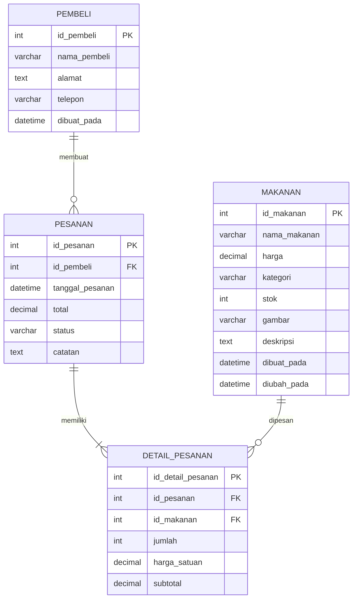

# Struktur Data — WarungKu

**Project:** Web Jualan Makanan WarungKu  
**Fase:** 1 — Perencanaan dan Analisis Program  
**Tanggal:** 18 Oktober 2026

## 1. Konsep Data

WarungKu memakai data relasional MySQL. Setiap makanan dapat muncul di banyak detail pesanan. Setiap pembeli dapat membuat banyak pesanan. Setiap pesanan memiliki satu atau lebih detail pesanan.



## 2. Struktur Data Makanan

| Field | Tipe Data MySQL | Aturan | Keterangan |
|---|---|---|---|
| `id_makanan` | `INT UNSIGNED AUTO_INCREMENT` | Primary key | ID unik makanan. |
| `nama_makanan` | `VARCHAR(100)` | Wajib, unik | Nama menu makanan atau minuman. |
| `harga` | `DECIMAL(12,2)` | Wajib, lebih dari 0 | Harga dalam Rupiah. `DECIMAL` dipakai agar nilai uang presisi. |
| `kategori` | `VARCHAR(50)` | Wajib | Contoh: Makanan, Minuman, Camilan. |
| `stok` | `INT UNSIGNED` | Wajib, minimal 0 | Jumlah stok tersedia. |
| `gambar` | `VARCHAR(255)` | Boleh kosong | Nama/path file gambar di `assets/images/`. |
| `deskripsi` | `TEXT` | Boleh kosong | Informasi singkat makanan. |
| `dibuat_pada` | `DATETIME` | Otomatis | Waktu data dibuat. |
| `diubah_pada` | `DATETIME` | Otomatis diperbarui | Waktu data terakhir diubah. |

**Contoh array PHP hasil database:**

```php
$daftarMenu = [
    [
        'id_makanan' => 1,
        'nama_makanan' => 'Nasi Goreng',
        'harga' => 15000.00,
        'kategori' => 'Makanan',
        'stok' => 20,
        'gambar' => 'nasi-goreng.jpg',
        'deskripsi' => 'Nasi goreng rumahan dengan telur.'
    ]
];
```

## 3. Struktur Data Pembeli

| Field | Tipe Data MySQL | Aturan | Keterangan |
|---|---|---|---|
| `id_pembeli` | `INT UNSIGNED AUTO_INCREMENT` | Primary key | ID unik pembeli. |
| `nama_pembeli` | `VARCHAR(100)` | Wajib | Nama lengkap pembeli. |
| `alamat` | `TEXT` | Wajib | Alamat pengantaran/pengambilan. |
| `telepon` | `VARCHAR(20)` | Wajib | Nomor telepon; `VARCHAR` agar angka awal `0` tidak hilang. |
| `dibuat_pada` | `DATETIME` | Otomatis | Waktu data pembeli dibuat. |

## 4. Struktur Data Pesanan

| Field | Tipe Data MySQL | Aturan | Keterangan |
|---|---|---|---|
| `id_pesanan` | `INT UNSIGNED AUTO_INCREMENT` | Primary key | ID unik pesanan. |
| `id_pembeli` | `INT UNSIGNED` | Foreign key, wajib | Menghubungkan pesanan dengan pembeli. |
| `tanggal_pesanan` | `DATETIME` | Otomatis | Waktu checkout dilakukan. |
| `total` | `DECIMAL(12,2)` | Wajib, minimal 0 | Total seluruh item pesanan. |
| `status` | `VARCHAR(20)` | Wajib | Nilai awal `Menunggu`; pilihan: Menunggu, Diproses, Selesai, Dibatalkan. |
| `catatan` | `TEXT` | Boleh kosong | Catatan pesanan dari pembeli. |

## 5. Struktur Data Detail Pesanan

Tabel ini menyimpan item makanan dalam satu pesanan. Diperlukan karena satu pesanan bisa memiliki banyak makanan, dan satu makanan bisa muncul dalam banyak pesanan.

| Field | Tipe Data MySQL | Aturan | Keterangan |
|---|---|---|---|
| `id_detail_pesanan` | `INT UNSIGNED AUTO_INCREMENT` | Primary key | ID unik detail pesanan. |
| `id_pesanan` | `INT UNSIGNED` | Foreign key, wajib | Pesanan induk. |
| `id_makanan` | `INT UNSIGNED` | Foreign key, wajib | Makanan yang dibeli. |
| `jumlah` | `INT UNSIGNED` | Wajib, minimal 1 | Jumlah makanan dibeli. |
| `harga_satuan` | `DECIMAL(12,2)` | Wajib | Harga makanan saat checkout. Disimpan agar riwayat harga tidak berubah jika harga menu diubah. |
| `subtotal` | `DECIMAL(12,2)` | Wajib | `jumlah × harga_satuan`. |

## 6. Struktur Data Keranjang Sementara

Keranjang tidak disimpan sebagai tabel pada versi dasar. Data disimpan dalam `$_SESSION['keranjang']` sebagai array selama pembeli berbelanja.

```php
$_SESSION['keranjang'] = [
    1 => [
        'id_makanan' => 1,
        'nama_makanan' => 'Nasi Goreng',
        'harga' => 15000.00,
        'jumlah' => 2,
        'subtotal' => 30000.00
    ]
];
```

Key array memakai `id_makanan` agar item sama tidak tersimpan ganda. Jika pembeli menambah menu sama, nilai `jumlah` diperbarui.

## 7. Data Form Checkout

```php
$dataPembeli = [
    'nama_pembeli' => 'Budi',
    'alamat' => 'Jl. Melati No. 1',
    'telepon' => '081234567890'
];

$dataPesanan = [
    'total' => 30000.00,
    'status' => 'Menunggu',
    'catatan' => 'Tidak pedas'
];
```

## 8. Relasi dan Aturan Integritas Data

1. Satu `pembeli` dapat mempunyai banyak `pesanan`.
2. Satu `pesanan` wajib mempunyai minimal satu `detail_pesanan`.
3. Satu `makanan` dapat muncul pada banyak `detail_pesanan`.
4. Makanan dengan `stok = 0` tidak boleh ditambahkan ke keranjang.
5. Harga makanan harus lebih dari `0`.
6. Jumlah pembelian minimal `1` dan tidak boleh melebihi stok.
7. Total pesanan dihitung ulang dari `detail_pesanan`, bukan dari input pengguna.
8. Pesanan yang sudah selesai tetap menyimpan `harga_satuan` lama pada `detail_pesanan`.

## 9. Tipe Data dan Control Program

### Tipe data program PHP

| Kebutuhan | Tipe PHP | Sumber |
|---|---|---|
| ID, stok, jumlah | `int` | Database/form tervalidasi |
| Harga, subtotal, total | `float` saat diproses; `DECIMAL` di MySQL | Database/perhitungan |
| Nama, kategori, alamat, telepon, status | `string` | Form/database |
| Daftar menu, keranjang, data checkout | `array` | Database/session/form |
| Data menu per baris | `array` asosiatif | Hasil query PDO |
| Ada/tidaknya kondisi | `bool` | Hasil validasi |

### Control program

| Control | Pemakaian | Contoh |
|---|---|---|
| `if / elseif / else` | Validasi form, cek stok, cek keranjang kosong, hasil query | Tolak checkout jika nama/alamat/telepon kosong. |
| `foreach` | Menampilkan daftar menu dan isi keranjang | Loop setiap item pada `$daftarMenu`. |
| `for` | Pengulangan berbasis indeks bila diperlukan | Menampilkan nomor urut data. |
| `switch` | Label/aturan kategori makanan | Kategori `Makanan`, `Minuman`, atau `Camilan`. |
| `try / catch` | Menangani error koneksi dan transaksi database | Batalkan penyimpanan pesanan jika salah satu query gagal. |

## 10. Validasi Awal

| Input | Validasi |
|---|---|
| Nama makanan | Tidak kosong, maksimal 100 karakter. |
| Harga | Angka, lebih dari 0. |
| Kategori | Harus termasuk kategori yang diizinkan. |
| Stok | Bilangan bulat, minimal 0. |
| Nama pembeli | Tidak kosong, maksimal 100 karakter. |
| Alamat | Tidak kosong. |
| Telepon | Tidak kosong, 10–20 karakter, hanya angka/`+`/spasi/dash. |
| Jumlah | Bilangan bulat, minimal 1, tidak melebihi stok. |
| Status pesanan | Hanya: Menunggu, Diproses, Selesai, Dibatalkan. |
